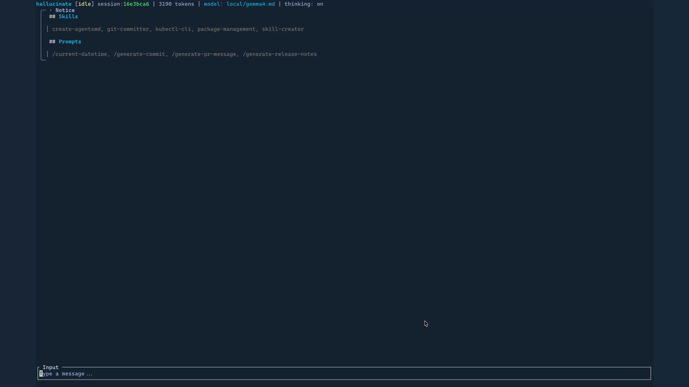

# Hallucinate

[![The image displays the Hallucinate logo featuring a stylized robotic face icon with a rounded square design set against a dark blue gradient background. The robot head is rendered in
glowing neon blue and white tones, giving it a holographic, futuristic appearance. Two simple circular dots serve as eyes on a dark screen-like face, framed by a luminous border that
appears to emit light from within. Below the head sits what resembles a computer terminal or server unit with a plus symbol and ventilation lines, all enclosed within a softly glowing
rounded square icon shape.](.forgejo/images/hallucinate_logo_wide.jpg)](.forgejo/images/hallucinate_logo_wide.jpg)

> [!CAUTION]
> I'm making this for myself. Use it if you want to, but I can't provide support for you.

An LLM terminal agent harness. A lot like [pi](https://github.com/earendil-works/pi), but built in Rust.

[](.forgejo/images/hallucinate_example_01.gif)

## 📋 Features

- **Interactive TUI** - Full terminal UI with syntax-highlighted markdown, multi-line editor with word-level cursor navigation, undo support, and keyboard-driven session/model pickers
- **Print mode** - Send a prompt and get the response printed to stdout, then exit
- **RPC mode** - JSON-RPC over stdin/stdout for programmatic integration
- **Provider support** - Supports any OpenAI-compatible provider with either Completions or Responses API endpoints
- **Tool use** - Built-in tools for `bash`, `grep`, `find`, `ls`, `read`, `write`, and `edit`
- **Image support** - Attach images to prompts for multimodal models (bmp, gif, jpeg, png, webp)
- **Skills & prompt templates** - Auto-discovered from user and project directories; manual loading via CLI flags
- **Thinking/reasoning visibility** - Toggle display of model chain-of-thought
- **Context window management** - Automatic compaction and truncation

## ⬇️ Installation

### From registry

```bash
cargo install --index "sparse+https://git.smalls.online/api/packages/smalls/cargo/" hallucinate
```

### From source

```bash
cargo install --path ./crates/hallucinate
```

### Build manually

```bash
make build-release-artifacts
# Binary is placed in artifacts/<os>_<arch>/hallucinate
```

### Requirements

- Rust 1.85+ (uses edition 2024)
- A supported LLM provider API and API key

## 🏃 Quick Start

For full documentation on how to use `hallucinate`, [click here](docs/README.md).

### 1. Configure a provider

Models are not included by default. Add at least one provider and model to `settings.toml` before starting a run mode. For example:

```toml
default_model = "local/llama-3"

[providers.local]
base_url = "http://localhost:1234/v1"

[providers.local.models.llama-3]
name = "Llama 3"
# Use `openai-responses` for providers exposing /responses.
# api = "openai-responses"
```

The settings file is stored in the application's configuration directory. Provider model IDs and metadata are user-configurable, so the same structure works for any OpenAI-compatible endpoint.

### 2. Authenticate with a provider

```bash
# Save an API key (prefer passing via environment variable)
hallucinate auth set <provider> --api-key "$HALLUCINATE_API_KEY"

# List saved providers
hallucinate auth list

# Remove a saved key
hallucinate auth remove <provider>
```

### 3. Interactive mode (default)

```bash
hallucinate
```

### 4. Print mode - one-shot prompt

```bash
hallucinate print "Explain why metalcore music is sometimes referred to as unga-bunga music"
```

### 5. RPC mode - JSON-RPC over stdin/stdout

```bash
hallucinate rpc
```

## 💻 Usage

```text
hallucinate [OPTIONS] [COMMAND]

Commands:
  auth  Save, remove, or list provider API keys
  print Send a prompt and print the response, then exit
  rpc   Run in RPC mode (JSON-RPC over stdin/stdout)

Options:
  -m, --model <MODEL>                       Model to use as a configured model ID or "provider/model" pair
      --api-key <API_KEY>                   API key for the provider. Overrides environment variables and stored credentials.
      --base-url <BASE_URL>                 Base URL for the API (for OpenAI-compatible providers)
      --shell <SHELL>                       Shell executable for the bash tool
      --session <SESSION>                   Resume this persisted session in interactive mode
      --max-tokens <MAX_TOKENS>             Maximum number of tokens in the response
      --thinking                            Show model thinking/reasoning in output
      --temperature <TEMPERATURE>           Temperature for sampling (0.0 - 2.0)
      --system-prompt <SYSTEM_PROMPT>       System prompt to use
      --image <IMAGES>                      Attach an image to a print-mode prompt (repeatable)
      --skill <SKILLS>                      Load a skill Markdown file or directory (repeatable)
      --no-skills                           Disable automatic skill discovery
      --prompt-template <PROMPT_TEMPLATES>  Load a prompt template file or directory (repeatable)
      --no-prompt-templates                 Disable automatic prompt template discovery
      --debug                               Write diagnostic logs to the application cache directory
  -h, --help                                Print help
  -V, --version                             Print version
```

## 🏗️ Build

| Target | Command |
| --- | --- |
| Debug build | `make build` |
| Release build | `make build-release` |
| Release + artifacts | `make build-release-artifacts` |
| Format code | `make format` |
| Check for errors | `make check` |
| Clean | `make clean` |

## 📂 Project Structure

The project is a Cargo workspace with four crates:

| Crate | Description |
| --- | --- |
| `hallucinate` | CLI binary - argument parsing and run-mode startup policy |
| `hallucinate-agent` | Agent core - LLM provider abstraction, runtime, tools, config, and skills |
| `hallucinate-session` | CLI-oriented append-only JSONL session persistence and lifecycle archival |
| `hallucinate-tui` | Terminal UI and interactive controller - rendering, editor, input, and commands |

## 🤝 License

MIT License - see [LICENSE](LICENSE) for details.

Copyright (c) 2026 Smalls.Online (Timothy Small)
